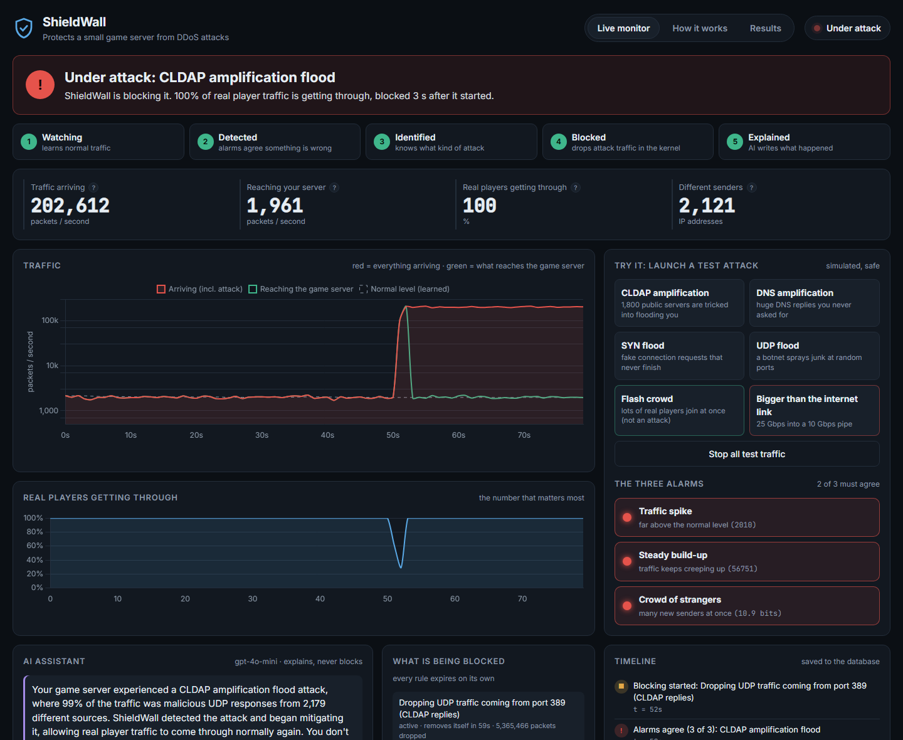
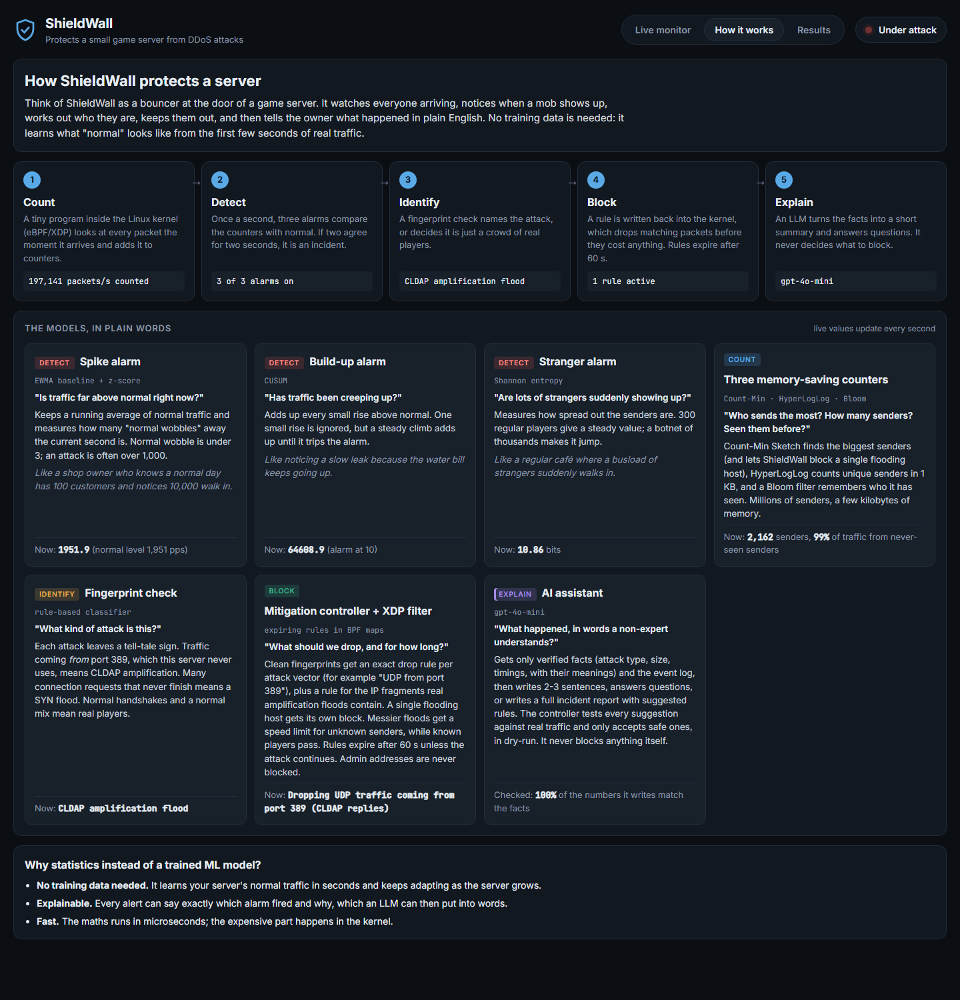
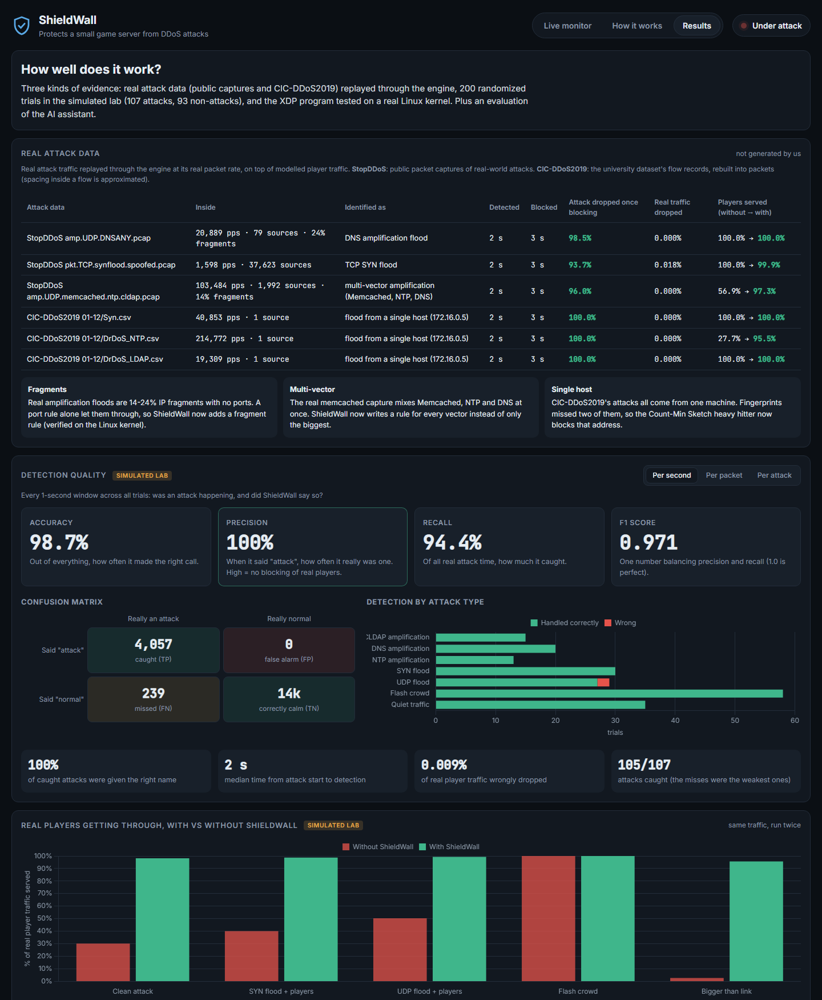

# ShieldWall

**An automatic, self-explaining bouncer for small servers.**
ShieldWall watches all traffic to one server, detects a DDoS attack in about 2 seconds, drops the attack traffic in the Linux kernel while real players keep playing, and explains in plain English what happened.

`C (eBPF/XDP) drops · Python decides · the LLM explains and suggests · SQLite remembers`



The dashboard has three tabs, written so anyone can follow along:

| Live monitor | How it works | Results |
|---|---|---|
| Plain-English status ("Under attack: CLDAP amplification flood. ShieldWall is blocking it."), a 5-step tracker, the three alarms, what is being blocked, a timeline, the AI assistant and incident reports | Each model explained with a question, an everyday analogy and its live value | Real attack data, simulated-lab accuracy, precision, recall and F1, kernel test and LLM evaluation |
|  |  |  |

## Highlights

- **Kernel-speed blocking.** An eBPF/XDP program drops attack packets inside the NIC driver, before the kernel network stack does any work. Tested on a real Linux kernel.
- **No fixed thresholds, no training.** Three statistical detectors vote (EWMA z-score, CUSUM, entropy) and learn each server's normal traffic live, with persistence and absolute-floor guards against false alarms.
- **Knows what hit you.** Fingerprints DNS, NTP, CLDAP and Memcached amplification (including multi-vector attacks), SYN floods, UDP floods and single-host floods, and tells a real rush of players apart from an attack.
- **Handles what real attacks look like.** IP fragments with no ports, several reflection vectors at once, and one machine sending most of the traffic (Count-Min Sketch heavy hitter), all found by replaying real attack data.
- **Safe by design.** Every rule expires, an allowlist is never dropped, the rule count is capped, and a dry-run mode logs without dropping.
- **Grows with your server.** A sustained legitimate surge becomes the new normal.
- **Explains and suggests, never blocks.** gpt-4o-mini writes plain-English summaries, answers questions from the event log and drafts incident reports with suggested rules. The controller tests every suggestion against real traffic and installs only safe ones, in dry-run. The LLM's answers are evaluated for hallucinations and faithfulness.

## Results

Three kinds of evidence, labelled clearly:

| Evidence | What it is |
|---|---|
| **Real attack data** | Public captures of real-world attacks and the CIC-DDoS2019 dataset, which we did not create, replayed through the engine |
| **Real Linux kernel** | The XDP program loaded on a Linux interface, with real packets sent through it |
| **Simulated lab** | Our traffic generator, where the right answer is known for every second. Players, the game server's capacity and the upstream provider are modelled here |

### 1. Real attack data

Real attack traffic replayed **through the engine** (its Python model of the filter, not the kernel; see section 2 for real captures through the real kernel) at its real packet rate for 30 s, mixed into modelled player traffic (~2,000 pps); ground truth is which packets came from the attack data. Full reports: [results/replay.md](results/replay.md), [results/replay_cic.md](results/replay_cic.md).

| Attack data | Inside | Identified as | Detected | Blocked | Attack dropped once blocking | Real traffic dropped | Players served (without → with) |
|---|---|---|---|---|---|---|---|
| Public capture amp.UDP.DNSANY.pcap | 20,889 pps, 79 sources, 24% fragments | DNS amplification flood | 2 s | 3 s | **98.5%** | 0.000% | 100.0% → **100.0%** |
| Public capture pkt.TCP.synflood.spoofed.pcap | 1,598 pps, 37,623 sources | TCP SYN flood | 2 s | 3 s | **93.8%** | 0.061% | 100.0% → **99.8%** |
| Public capture amp.UDP.memcached.ntp.cldap.pcap | 103,484 pps, 1,992 sources, 14% fragments | multi-vector amplification (Memcached, NTP, DNS) | 2 s | 3 s | **99.1%** | 0.000% | 56.9% → **97.3%** |
| CIC-DDoS2019 01-12/Syn.csv | 40,853 pps, 1 source | flood from a single host (172.16.0.5) | 2 s | 3 s | **100.0%** | 0.000% | 100.0% → **100.0%** |
| CIC-DDoS2019 01-12/DrDoS_NTP.csv | 214,772 pps, 1 source | flood from a single host (172.16.0.5) | 2 s | 3 s | **100.0%** | 0.000% | 27.7% → **95.5%** |
| CIC-DDoS2019 01-12/DrDoS_LDAP.csv | 19,309 pps, 1 source | flood from a single host (172.16.0.5) | 2 s | 3 s | **100.0%** | 0.000% | 100.0% → **100.0%** |

**Public captures** come from [StopDDoS/packet-captures](https://github.com/StopDDoS/packet-captures) ("packet captures of real-world ddos attacks"; free to use for building DDoS protection). **CIC-DDoS2019** is the CSV release (CICFlowMeter flow records): for each file, the busiest 30 s of attack flows were rebuilt into packets with their real addresses, ports, protocols, packet counts, sizes and timing. Only the spacing of packets inside a flow is approximated.

**What real data taught us (and what we fixed):**
- **Fragments.** Real amplification floods are 14-24% IP fragments, which carry no port numbers. A port rule let them through, so ShieldWall now adds a fragment rule, in the simulator and in the XDP program.
- **Multi-vector attacks.** The memcached capture mixes Memcached, NTP and DNS reflection at once. ShieldWall now writes a rule for every vector, not just the biggest.
- **Single-host floods.** Every CIC-DDoS2019 attack comes from one machine (172.16.0.5), and its "DrDoS" attacks don't use the reflection port. Fingerprints missed two of the three, so the Count-Min Sketch heavy hitter now handles a single never-seen flooding address: blocked outright, or rate-limited to a fair share if its traffic goes to the game's own ports (it could be many players behind one shared address).
- **Small vectors.** CLDAP was only 3.1% of the multi-vector capture, under the 5% cutoff, so it slipped through. Once amplification is confirmed, every reflection port present now gets a rule.
- **Low-rate SYN floods.** A real 1.6k pps SYN flood showed our SYN thresholds were too strict and the rate limit too loose. Both were tightened (still a 10x margin above normal traffic).

#### Held-out test: run once, after the code was frozen

Thresholds and rules above were adjusted using those six files, so they are not a test on unseen data. To get one, the code was frozen and run **once** on data nobody had looked at: five more public captures and three more CIC-DDoS2019 files. Full reports: [results/heldout_replay.md](results/heldout_replay.md), [results/heldout_replay_cic.md](results/heldout_replay_cic.md).

| Attack data | Inside | Identified as | Detected | Blocked | Attack dropped once blocking | Real traffic dropped | Players served (without → with) |
|---|---|---|---|---|---|---|---|
| Public capture amp.dns.RRSIG.fragmented.pcap | 148 pps, 237 sources, 16% fragments | not detected | - s | - s | not blocked | 0.000% | 100.0% → **100.0%** |
| Public capture amp.UDP.snmp.src161.pcapng | 186,108 pps, 4,276 sources | UDP flood | 2 s | 3 s | **92.9%** | 0.282% | 31.9% → **94.8%** |
| Public capture amp.UDP.isakmp.pcap | 9,744 pps, 2,767 sources | UDP flood | 2 s | 3 s | **93.8%** | 0.265% | 100.0% → **99.1%** |
| Public capture amp.TCP.reflection.SYNACK.pcap | 54,465 pps, 7,055 sources | not detected | - s | - s | not blocked | 0.000% | 100.0% → **100.0%** |
| Public capture pkt.UDP.rdm.fixedlength.pcapng | 927 pps, 11 sources | not detected | - s | - s | not blocked | 0.000% | 100.0% → **100.0%** |
| CIC-DDoS2019 01-12/UDPLag.csv | 21,847 pps, 1 source | flood from a single host (172.16.0.5) | 2 s | 3 s | **100.0%** | 0.000% | 100.0% → **100.0%** |
| CIC-DDoS2019 03-11/Portmap.csv | 12,394 pps, 1 source | flood from a single host (172.16.0.5) | 2 s | 3 s | **100.0%** | 0.000% | 100.0% → **100.0%** |
| CIC-DDoS2019 01-12/DrDoS_SSDP.csv | 32,872 pps, 1 source | flood from a single host (172.16.0.5) | 2 s | 3 s | **100.0%** | 0.000% | 100.0% → **100.0%** |

**5 of 8 were caught.** SNMP and ISAKMP amplification use ports that aren't on ShieldWall's list, and the generic UDP-flood rule still stopped them. Two weren't flagged because they're below the alert floor (148 and 927 packets/s, which don't hurt the server: players stayed at 100%). **One is a real miss:** TCP SYN-ACK reflection at 54k pps from 7,055 sources set off the alarms, but matched no fingerprint, and ShieldWall deliberately doesn't block traffic it can't classify. That is the main gap the held-out test found; the three CIC-DDoS2019 files were all single-host floods again.

**What CIC-DDoS2019 can and can't test.** Every CIC attack comes from one machine, the "NTP" and "LDAP" attacks don't use ports 123 and 389, and the "Syn" flows rebuild with no SYN flags. So CIC tests the single-host rule; only the public captures test the attack-type fingerprints. Several CIC attacks were also too small to hurt the modelled server (players at 100% with or without ShieldWall).

### 2. Real Linux kernel

**Real captures through the real XDP program.** [tests/xdp_replay_test.sh](tests/xdp_replay_test.sh) runs modelled players for a baseline, then sends every packet of a real capture (rewritten to the test server's address) through the XDP program on Linux, while the live control loop (`shieldwall live`'s loop) reads the kernel maps, detects, classifies and writes the rules. Afterwards the whole capture is sent once more with the rules active, so the kernel's own counters give exact drop numbers. [results/kernel_replay.json](results/kernel_replay.json)

| Capture | Classified as (live loop) | Detected | Blocked | Capture packets dropped by the kernel | Player packets dropped | Rules |
|---|---|---|---|---|---|---|
| amp.UDP.DNSANY.pcap | DNS amplification flood | 2 s | 2 s | **11,820 / 11,998** (98.5%) | 0 / 300 | DROP UDP src port 53; DROP UDP fragments from unknown sources |
| amp.UDP.memcached.ntp.cldap.pcap | multi-vector amplification (Memcached, NTP, DNS) | 2 s | 2 s | **29,205 / 29,462** (99.1%) | 0 / 300 | DROP UDP src port 11211; DROP UDP src port 123; DROP UDP src port 53; DROP UDP src port 389; DROP UDP fragments from unknown sources |

The packets that got through are the capture's handful of non-amplification packets (ICMP, a few others).

**Kernel feature test.** 
[tests/xdp_kernel_test.sh](tests/xdp_kernel_test.sh) loads the XDP program on a veth interface (Linux 6.18, WSL2), sends crafted packets with scapy and checks each kernel feature against the real BPF maps:

```
normal window : 400 pkts, amp share 0%, 20 sources
attack window : 3000 pkts, amp share 100% from port 389, ~506 sources -> CLDAP amplification flood
with rule     : kernel dropped 3000 attack pkts, passed 400 player pkts, rule hits 3000
fragments     : kernel saw 1000 fragments, dropped 1000
heavy hitter  : blocklist dropped 2000 packets from 45.30.0.9, passed 300 others
icmp flood    : blocklist dropped 500 of 500 pings from 45.30.0.9
shared address: rate limit passed 152 of 2000 packets (fair share ~100/s plus burst)
expiry        : 0 of 200 packets dropped after the entry expired (should be 0)
dry-run       : dropped 0 (should be 0)
KERNEL TEST PASSED
```

The blocklist covers every protocol (it's checked before the TCP/UDP parsing), and its entries expire inside the kernel, so an address can't stay blocked if the controller crashes.

The program passes the kernel verifier and is JIT-compiled.

### 3. Simulated lab

**200 randomized trials**, half attacks (CLDAP, DNS, NTP, SYN, UDP at 3k-300k pps, random timing and ramp) and half not (flash crowds of real players, quiet traffic). Full report: [results/metrics.md](results/metrics.md).

| Level | Accuracy | Precision | Recall | F1 |
|---|---|---|---|---|
| Per 1-second window | 98.668% | **100%** | 94.437% | 0.971 |
| Per packet dropped | 97.209% | **99.991%** | 96.642% | 0.983 |
| Per attack (incident) | 99.000% | **100%** | 98.131% | 0.991 |

- **0 of 93** non-attacks (flash crowds and quiet runs) were wrongly mitigated; 0.042% of real traffic was dropped across all trials (new players stay untrusted until seen in 5 calm seconds, so a few get rate-limited during attacks).
- 100% attack-type accuracy on caught attacks; median time to detect 2 s; 105/107 attacks caught (the misses were the weakest, close to normal volume).

**What the metrics mean.** *Precision*: when ShieldWall says "attack", how often it really is one (low precision means blocking real players). *Recall*: of all real attack time, how much it caught. *F1*: the balance of the two. Per-second recall is below 100% by design: the 2-second persistence guard counts the first seconds of every attack as misses, and that guard is what keeps false alarms at zero.

**Four scenarios, with vs without ShieldWall** (same seeded traffic; ~2,000 pps of players, server capacity 60k pps, 10 Gbps uplink). Full report: [results/results.md](results/results.md).

| Scenario | Classified as | Real traffic served WITHOUT | WITH | Detect | Mitigate |
|---|---|---|---|---|---|
| S1 Clean attack: CLDAP amplification | CLDAP amplification flood | 30.2% | **98.1%** | 2 s | 3 s |
| S2a Attack mixed with real traffic: SYN flood on the game port | TCP SYN flood | 40.1% | **98.6%** | 2 s | 3 s |
| S2b Attack mixed with real traffic: UDP flood | UDP flood | 50.3% | **98.6%** | 2 s | 3 s |
| S3 Legitimate spike, no attack (flash crowd) | legitimate traffic surge | 100.0% | **100.0%** | 3 s | n/a |
| S4 Attack bigger than the link (25 Gbps into 10 Gbps) | CLDAP amplification flood | 2.8% | **95.7%** (via simulated provider) | 2 s | 4 s |

### 4. The LLM: is it correct, fast and cheap?

`shieldwall llm-eval` sends the exact production prompts for real engine incidents to gpt-4o-mini and scores the answers automatically. Full report: [results/llm_eval.md](results/llm_eval.md).

| Metric | Prompt v1 | Final prompt | Final prompt, held-out incidents |
|---|---|---|---|
| Numbers that match the facts (hallucination check) | 58/58 | 61/61 | **66/66** |
| Claims judged supported with the right meaning (LLM-as-judge) | 92% | 100% | **100%** |
| Explanations where every claim is supported | 62% | 100% | **100%** |
| Names the correct attack, or calls a surge real players | 100% | 100% | **100%** |
| Chat answers over the event log that contain the right answer | 100% | 100% | **100%** |
| Rule suggestions accepted by the controller (in dry-run) | 0/15 | 7/12 | **7/13** |
| Median latency (background, never delays blocking) | 1.4 s | 1.5 s | **1.5 s** |
| Cost per explanation | $0.00010 | $0.00011 | **$0.00011** |

**What changed, based on what the evaluation found.** Prompt v1 over-claimed ("98% got through *without any impact*"), once called a UDP flood "not malicious", and kept suggesting blocks on single reflector addresses that each sent ~0.1% of a distributed attack, which the controller rejected. The final prompt tells the model to state numbers exactly, gives it each top sender's share of the traffic (source blocks only above 20%), and adds plain status fields (`incident_over`, `blocking_now`) after a live run showed it confusing "not over yet" with "not blocked". The controller also gained a rule the evaluation motivated: no drop rules on the game's own ports, only rate limits. The judge is the same model (gpt-4o-mini) prompted as a strict fact-checker, so it is a check, not proof. The prompt was tuned on the first set of incidents; the held-out column uses new incidents (different seeds) it never saw. Reports: [v1](results/llm_eval_prompt_v1.md), [final](results/llm_eval.md), [held-out](results/llm_eval_heldout.md).

## How it works

```
                 Attacker botnet            Real players
                        \                      /
                         v                    v
  KERNEL  (C / eBPF)  +-------------------------------------+
  data plane          |  XDP program: parse -> count -> drop |  every packet, microseconds
                      +-------------------------------------+
                           |  counter maps     ^  rule maps + blocklist
                           v  (read)           |  (write)
  USERSPACE (Python)  +-------------------------------------+
  control plane       |  featurise -> detect -> classify ->  |  once a second
                      |  mitigate (expiring rules, safety)   |
                      +-------------------------------------+
                           |                    |
                    LLM assistant          SQLite event log -> dashboard
             (explains, suggests; the controller validates; never blocks)
```

**Two clocks.** The kernel does the cheap, high-volume work (count and drop) on every packet. Userspace does the expensive thinking (detect and decide) once a second. BPF maps are the only bridge.

### 1. Data plane: [bpf/xdp_filter.c](bpf/xdp_filter.c)
Parse headers, count into maps, check allowlist, blocklist and rules, drop or pass. It counts *before* dropping, so the detector keeps seeing an attack while it's being blocked, and it recognises IP fragments (which have no ports). Maps: `stats`, `src_count`, `udp_sport_count`, `rules` (capped at 64), `blocklist` and `allowlist` (LPM tries), `trusted`, `config` (enforce / dry-run).

### 2. Detection: three methods vote ([detectors.py](controlplane/shieldwall/detectors.py))
| Method | Formula | Catches |
|---|---|---|
| EWMA baseline + z-score | `z = (x - mu) / sigma` | sudden spikes |
| CUSUM | `S_t = max(0, S_{t-1} + z_t - k)` | slow ramps a single z-score misses |
| Entropy | `H = -sum p_i log2 p_i` over source IPs | sudden changes in how spread out the senders are |

An alert needs 2 of 3 votes, must persist for 2 windows, and must clear an absolute floor. The baseline freezes during anomalies so an attack never becomes "normal"; only a surge confirmed as legitimate for 30 s is adopted as the new baseline.

### 3. Probabilistic data structures ([sketches.py](controlplane/shieldwall/sketches.py))
| Structure | Question | Memory |
|---|---|---|
| Count-Min Sketch | who are the top talkers? (and is one host flooding us?) | 64 KB |
| HyperLogLog | how many unique sources? | 1 KB, ~3% error |
| Bloom filter | have I seen this source before? | ~240 KB for 200k sources |

### 4. Classify by fingerprint ([classifier.py](controlplane/shieldwall/classifier.py))
| Attack | Fingerprint |
|---|---|
| DNS / NTP / CLDAP / Memcached amplification | UDP arriving *from* service ports the server never uses (one or several at once), plus fragments of oversized replies |
| SYN flood | SYNs at more than half the ACK rate (normal is about 1 per 100) |
| Single-host flood | one never-seen address sends most of the traffic |
| UDP flood | UDP share jumps, mostly never-seen sources |
| Legit surge | volume up, but handshakes complete and the protocol mix is normal |

### 5. Mitigation ([mitigation.py](controlplane/shieldwall/mitigation.py))
A signature drop per attack vector, a fragment rule, a heavy-hitter block, or a token-bucket rate limit for unknown sources (sources that completed handshakes in calm times keep passing). Every rule expires after 60 s unless it still matches traffic. If the link itself is full for 3 windows, the drop rule is escalated upstream as BGP FlowSpec. **This escalation is simulated**: the simulator plays the provider; there is no BGP speaker in this build.

### 6. LLM layer ([llm.py](controlplane/shieldwall/llm.py), [llm_report.py](controlplane/shieldwall/llm_report.py))
Runs off the blocking path. It receives only verified facts, with the meaning of each field spelled out. It explains incidents, answers questions from the SQLite log, and writes structured post-incident reports (strict JSON schema) with up to three suggested rules. Each suggestion is validated by the controller: it must be specific, hit under 1% of recent normal traffic, match at least 5% of the attack, and not duplicate an existing rule. Accepted rules start in dry-run. Backends: OpenAI gpt-4o-mini (default when `OPENAI_API_KEY` is set), Claude, Ollama, or a built-in template; any error falls back to the template.

## Run it

Needs Python 3.10+. The core has no dependencies.

```bash
git clone https://github.com/SushrithKbtech/shieldwall.git
cd shieldwall
pip install -e .
```

| Command | What it does |
|---|---|
| `shieldwall dashboard` | live dashboard at http://127.0.0.1:8000 |
| `shieldwall demo --attack cldap` | one attack, step by step in the terminal |
| `shieldwall replay capture.pcap ...` | replay real attack captures (.pcap / .pcapng) -> `results/replay.md` |
| `shieldwall replay-cic archive.zip --member 01-12/Syn.csv` | replay CIC-DDoS2019 flow records straight from the dataset zip -> `results/replay_cic.md` |
| `shieldwall eval` | four simulated scenarios -> `results/results.md` |
| `shieldwall metrics` | accuracy / precision / recall / F1 over 200 simulated trials -> `results/metrics.md` |
| `shieldwall llm-eval` | LLM grounding, faithfulness, suggestions, latency and cost (needs `OPENAI_API_KEY`) |
| `pytest -q` | unit, replay and end-to-end tests (`pip install pytest`) |

Add `--report` to `replay` / `replay-cic` for an LLM incident report per attack. For the LLM: `pip install openai` and set `OPENAI_API_KEY`.

### On Linux with the real XDP program

```bash
sudo apt install clang llvm libbpf-dev linux-tools-generic python3-scapy
make -C bpf
sudo bash tests/xdp_kernel_test.sh                 # kernel test on a veth pair
sudo shieldwall live --iface eth0 --dry-run        # protect a real interface, log only
sudo shieldwall live --iface eth0                  # enforce
```

## Repo layout

```
bpf/xdp_filter.c              kernel data plane (C, eBPF/XDP)
controlplane/shieldwall/
  sketches.py                 Count-Min, HyperLogLog, Bloom
  features.py                 counters -> features (rates, ratios, entropy, fragments, heavy hitter)
  detectors.py                EWMA z-score, CUSUM, entropy vote, re-baselining
  classifier.py               attack fingerprints, legit-surge check
  mitigation.py               expiring rules, safety, escalation, LLM-suggestion validator
  bpf_dataplane.py            live loader for the real XDP maps (Linux)
  pcap.py, replay.py          real capture reader and replay
  cic.py                      CIC-DDoS2019 flow-record replay
  simulator.py                lab traffic generator: players, attacks, link, server
  engine.py                   the per-second control loop
  llm.py, llm_report.py       explainer, chat, incident reports and rule suggestions
  store.py                    SQLite event log
  server.py, ../dashboard/    live dashboard
  evaluate.py, metrics.py     simulated scenarios, accuracy/precision/recall/F1
  llm_eval.py                 LLM evaluation (grounding, LLM-as-judge, suggestions, cost)
tests/                        unit, replay, end-to-end and kernel tests
results/                      latest results (Markdown + JSON)
docs/                         presentation script and slides (.pptx and .pdf)
```

## Known limits

- **Upstream escalation is simulated.** Floods bigger than the uplink need a provider that accepts FlowSpec; the simulator plays that provider.
- **The players and the game server are modelled** in the simulated lab and the replays (the server is a 60k packets/s capacity). The attack traffic in the replays is real.
- **CIC-DDoS2019 is flow records, not packets.** Packets are rebuilt from the flows; spacing inside a flow is approximated.
- **IPv4 only**; IPv6 traffic is passed through untouched. HTTP (layer 7) floods are not classified.
- **No throughput benchmark yet.** Measuring packets per second per core needs a Linux machine or VM whose network driver supports native XDP (most cloud VMs do); it hasn't been run.
- **The live loader reads maps through `bpftool`**, fine up to tens of thousands of sources; a libbpf reader would be needed for much larger botnets.

## Safety and ethics

All attack traffic is replayed or generated inside an isolated lab with no route to the internet. Never point attack tools at anything you don't own, and never use stresser services.

## Team RSST

| Name | USN |
|---|---|
| Rohit Jaysheel Diggi | 1RVU23CSE384 |
| Saran Chekka | 1RVU23CSE411 |
| Sushrith Kandagatla | 1RVU23CSE489 |
| Tamish Sridatta Billa | 1RVU23CSE498 |

## v2 additions (three-tier detection + ML + LLM analyst)

This version adds a trained ML classifier and an LLM analyst on top of the original engine:

- **Tier 1 — statistics** (EWMA/CUSUM/entropy vote): the existing detector.
- **Tier 2 — ML classifier** (`controlplane/shieldwall/ml.py`, trained by `ml_train.py`): names attack families including ones the hand-written fingerprints miss (e.g. SYN-ACK reflection). See `results/ml_eval.md`.
- **Tier 3 — LLM analyst** (`controlplane/shieldwall/analyst.py`): investigates residual anomalies and proposes one rule, which the controller validates and installs in dry-run. Works offline; a real API key swaps in.

The cascade lives in `controlplane/shieldwall/cascade.py` and is wired into both the simulator engine and the real-kernel live loop.

**Live Minecraft test:** `results/live_minecraft.md` + the `mc-demo/` harness. Quick start in `docs/DEMO_RUNBOOK.md`.

```bash
pip install -e . scikit-learn joblib
python -m shieldwall.ml_train     # trains results/ml_model.joblib
pytest -q                         # 26 tests
```
